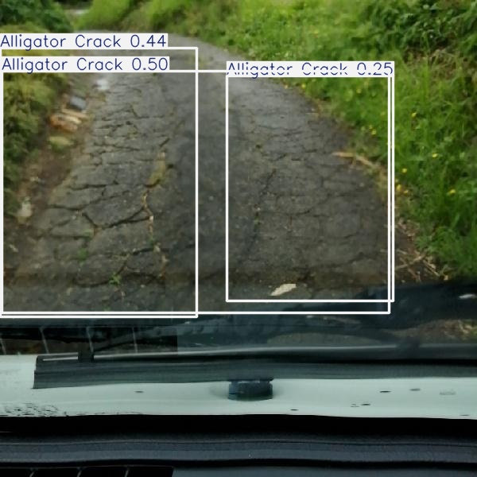
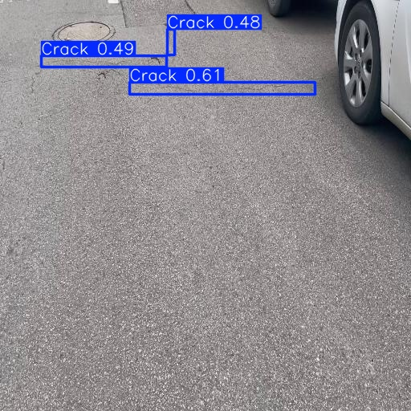

# Road damage: detection, segmentation, continual learning

Три задачи по компьютерному зрению на дорожном покрытии (Skoltech, весна 2025).

| Задача | Данные | Модель | Результат |
|---|---|---|---|
| [Task1](Task1) — детекция дефектов | RDD2022: China_MotorBike (1 класс), Japan (4 класса) | YOLO11s | mAP50 0.906 / mAP50-95 0.595 (China), 0.599 / 0.310 (Japan) на валидации |
| [Task2](Task2) — сегментация трещин | CRACK500 | U-Net++ (ResNet34), Dice / Tversky / CE+Dice | IoU 0.666, F1 0.809 (Dice) |
| [Task3](Task3) — continual learning | PermutedMNIST, SplitCIFAR10 | LeNet; Naive, EWC, Cumulative (Avalanche) | PMNIST: stream accuracy 93.8% (Cumulative), 44.8% (EWC) |

Task1 и Task2 упакованы в Docker (GPU/CPU), образы на Docker Hub: `marymikkey/yolo_road_damage`, `marymikkey/crack_semsegm_unetpp`.

  
  

Датасеты и веса в репозиторий не входят. RDD2022 и CRACK500 — открытые датасеты; структура папок описана в README каждой задачи.

Stack: Python, PyTorch, Ultralytics, segmentation-models-pytorch, Avalanche, OpenCV, Docker.
